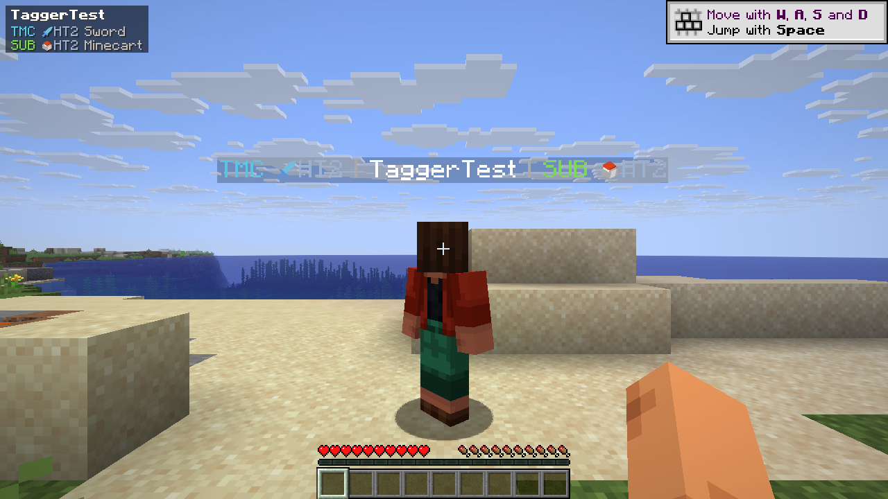
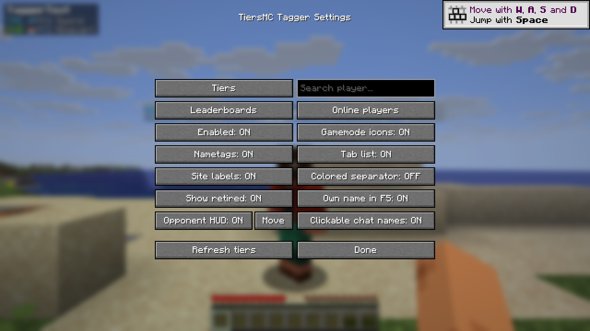

<p align="center">
  
</p>

# TiersMC Tagger

**TierMC and SubTiers ranks beside player names.**

A Fabric client mod forked from [QTiers](https://github.com/Adrian1337afk/qtiers), made for the [TierMC tier list](https://tiermc.com). The TierMC team can use, modify and publish this fork under the project's GPL-3.0 license.

[Download v1.0.1](https://github.com/Adrian1337afk/tiersmc-tagger/releases/tag/v1.0.1) · [Changelog](CHANGELOG.md) · [Report an issue](https://github.com/Adrian1337afk/tiersmc-tagger/issues)

## What it does

- **Nametags and tab list:** show TierMC and SubTiers on either side of a player's name, or turn either source off.
- **Per-site gamemodes:** choose a mode or show the player's highest tier, with each site's own icons and colored ranks.
- **Player profiles:** `/tiersmc <player>` opens a skin render, current and peak tiers, points, rank and region where available.
- **Opponent HUD:** shows the ranks of the last player you hit. Open settings and press **Move** to drag the HUD; its position is saved.
- **Your own name in F5:** optionally display your nametag and tiers in third person.
- **More ways to browse:** player search, online players, leaderboards and side-by-side player comparisons.
- **Clickable chat names:** open a player's profile from supported chat messages.
- **Saved results:** cached ranks carry over between sessions and refresh in the background.

Only **TierMC** and **SubTiers** are included. The mod runs on your client; servers do not need to install it.

## Screenshots

Real development-client captures using a local dummy player and sample ranks, rather than live player results.





## Downloads and requirements

Choose **one** jar for your Minecraft version. All six files belong to release **1.0.1**.

| Minecraft | Download | Required Java |
|---|---|---|
| 1.21.4 | [1.21.4 jar](https://github.com/Adrian1337afk/tiersmc-tagger/releases/download/v1.0.1/tiersmc-tagger-1.0.1%2B1.21.4.jar) | 21+ |
| 1.21.8 | [1.21.8 jar](https://github.com/Adrian1337afk/tiersmc-tagger/releases/download/v1.0.1/tiersmc-tagger-1.0.1%2B1.21.8.jar) | 21+ |
| 1.21.11 | [1.21.11 jar](https://github.com/Adrian1337afk/tiersmc-tagger/releases/download/v1.0.1/tiersmc-tagger-1.0.1%2B1.21.11.jar) | 21+ |
| 26.1.x | [26.1 jar](https://github.com/Adrian1337afk/tiersmc-tagger/releases/download/v1.0.1/tiersmc-tagger-1.0.1%2B26.1.jar) | 25+ |
| 26.2 | [26.2 jar](https://github.com/Adrian1337afk/tiersmc-tagger/releases/download/v1.0.1/tiersmc-tagger-1.0.1%2B26.2.jar) | 25+ |
| 26.3 | [26.3 jar](https://github.com/Adrian1337afk/tiersmc-tagger/releases/download/v1.0.1/tiersmc-tagger-1.0.1%2B26.3.jar) | 25+ |

1. Install [Fabric Loader](https://fabricmc.net/use/installer/) for your Minecraft version. For 26.x, use Loader 0.20.1 or newer.
2. Put the matching TiersMC Tagger jar and [Fabric API](https://modrinth.com/mod/fabric-api) in that instance's `mods` folder.
3. Launch Minecraft and run `/tiersmc` to configure the mod. [Mod Menu](https://modrinth.com/mod/modmenu) is optional.

The 26.1.x jar targets 26.1.2. Local dev-client checks covered 1.21.4, 1.21.8, 26.1.2, 26.2 and 26.3, including fixture nametags, settings and HUD rendering. These checks do not verify every 26.1 patch or public-server behavior.

## Commands

| Command | Action |
|---|---|
| `/tiersmc` or `/tiersmc settings` | Open settings |
| `/tiersmc <player>` | Open a player's profile |
| `/tiersmc list` | Show online players and their ranks |
| `/tiersmc top` | Browse TierMC and SubTiers leaderboards |
| `/tiersmc compare <a> <b>` | Compare two players |
| `/tiersmc reload` | Reload settings and refresh cached ranks |
| `/tiersmc debug` | Write player identity and nametag diagnostics to the game log |

Press **H** to open the nearest player's profile. Other shortcuts can be assigned in Minecraft's Controls menu.

## Missing tiers?

Check that the mod and **Nametags** are enabled, and that the tier list's position is **Left** or **Right**. A player needs a visible rank for the selected mode, or a highest-tier fallback.

Use `/tiersmc <player>` to check their profile, then `/tiersmc reload` to request fresh data. Servers that replace vanilla names with custom text displays or fake tab entries can behave differently. If profiles work but nametags do not, run `/tiersmc debug` near the affected player and attach `logs/latest.log` to an issue. Live API and mcpvp.club compatibility remain separate from the local tests above.

## TierMC Discord servers

Join the relevant gamemode community to get tested:

| Gamemode | Discord |
|---|---|
| Vanilla | [Join](https://discord.gg/VswgH4CT5c) |
| SMP | [Join](https://discord.gg/rYvJZUbX5R) |
| Potion | [Join](https://discord.gg/87VuPEDxu7) |
| Nethpot | [Join](https://discord.gg/kpBB29ZAnG) |
| Axe | [Join](https://discord.gg/VhsdMPTT5y) |
| Mace | [Join](https://discord.gg/XWD5VPwmPe) |
| UHC | [Join](https://discord.gg/vD9DmsnrM8) |
| Sword | [Join](https://discord.gg/6h77S8JmCV) |

## Building from source

Use the included Gradle wrapper with a JDK supported by Gradle 9.8.0; this project was built and tested with **JDK 26**.

```powershell
.\gradlew.bat collectJars
```

On macOS or Linux, use `./gradlew collectJars`. All six jars are written to `build/libs/`. Shared API, config and asset code lives in `common/`; Minecraft-specific code lives in `versions/<version>/`.

## Credits and license

- **Original mod:** [QTiers](https://github.com/Adrian1337afk/qtiers), by qdran.
- **Tier data:** [TierMC](https://tiermc.com/api.html) and [SubTiers](https://subtiers.net).
- **Gamemode icons:** supplied by the respective tier-list websites; their rights remain with their owners.
- **Skin renders:** [Visage](https://visage.surgeplay.com), with [mc-heads](https://mc-heads.net) as a fallback.

Source code is licensed under **GNU GPL v3.0**; see [LICENSE](LICENSE). Third-party icons retain their respective owners' rights.
